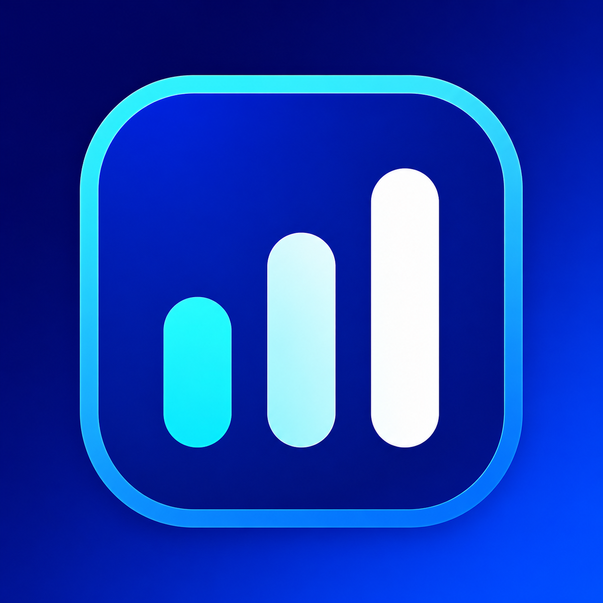

# CodexBar for Windows



An unofficial Windows system-tray simpler port of [CodexBar](https://github.com/steipete/CodexBar) for viewing Codex usage limits.

## Features

- Codex usage windows, reset times, account switching, and local session history.
- Claude subscription usage windows, including Sonnet and Opus limits, with separate account switching.
- Compact account initials in the header; hover to see the account email.
- Optional remote history over SSH without installing a helper or downloading session files.

## Privacy and credentials

CodexBar has no telemetry. Codex requests are sent directly to OpenAI endpoints.
Claude requests are sent directly to Anthropic endpoints. Sign in using **Add Account** (requires Claude Code),
or import a Claude Code `.credentials.json` through the Claude tab or Settings → Claude Accounts.

- Existing Codex credentials are read from `~/.codex/auth.json`.
- Managed Codex accounts are copied to `~/.codexbar/codex-accounts/` so the Codex CLI can use them.
- Removing a managed account deletes its directory under `~/.codexbar/codex-accounts/`.
- Account tabs only change the account viewed in CodexBar. Cached usage appears immediately while fresh data loads in the background.
- Existing Claude Code credentials are read from `~/.claude/.credentials.json` (or `CLAUDE_CONFIG_DIR`).
- Managed Claude credentials are stored in `~/.codexbar/claude-accounts/`. CodexBar renews these private copies; Claude Code owns renewal of the ambient system login. Removing an account deletes only its managed directory.
- When remote history is configured, **Make System** also selects file-based CLI credentials and replaces the remote Codex `auth.json` over SSH. The original auth and config are preserved once with `.codexbar-backup` suffixes.
- Remote history uses the system `ssh` client, your existing SSH config/keys, and Python 3 on the remote host. The bundled calculator is piped to Python over SSH and returns only aggregate JSON; it is not stored remotely.

Configure an SSH alias or `user@host` and the remote Codex home in Settings. Leave the SSH target blank to disable remote history.

Do not use the application on a shared Windows account unless you accept that local credential-storage model.

## Development

Requires Node.js 22 or newer and npm.

```powershell
npm ci
npm test
npm run dev
```

Build the Windows installer with:

```powershell
npm run build
npm run package
```

Installer output is written to `out/`.

## License

MIT. Derived from [CodexBar](https://github.com/steipete/CodexBar) by Peter Steinberger; see [LICENSE](LICENSE).
